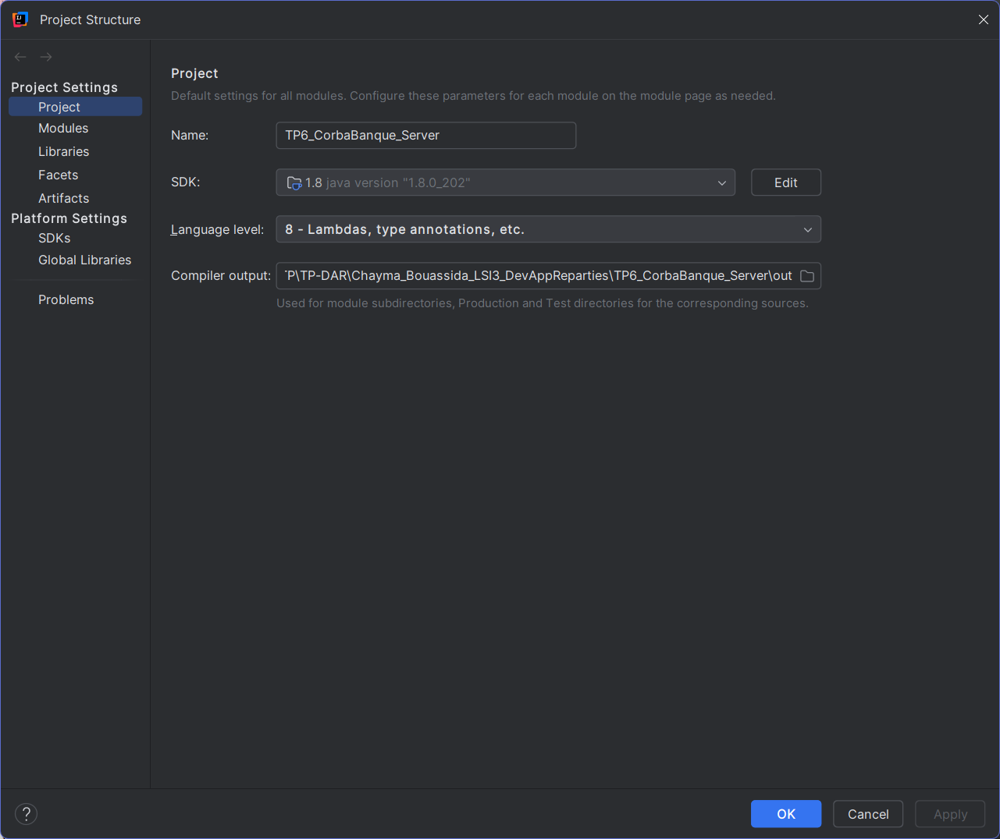
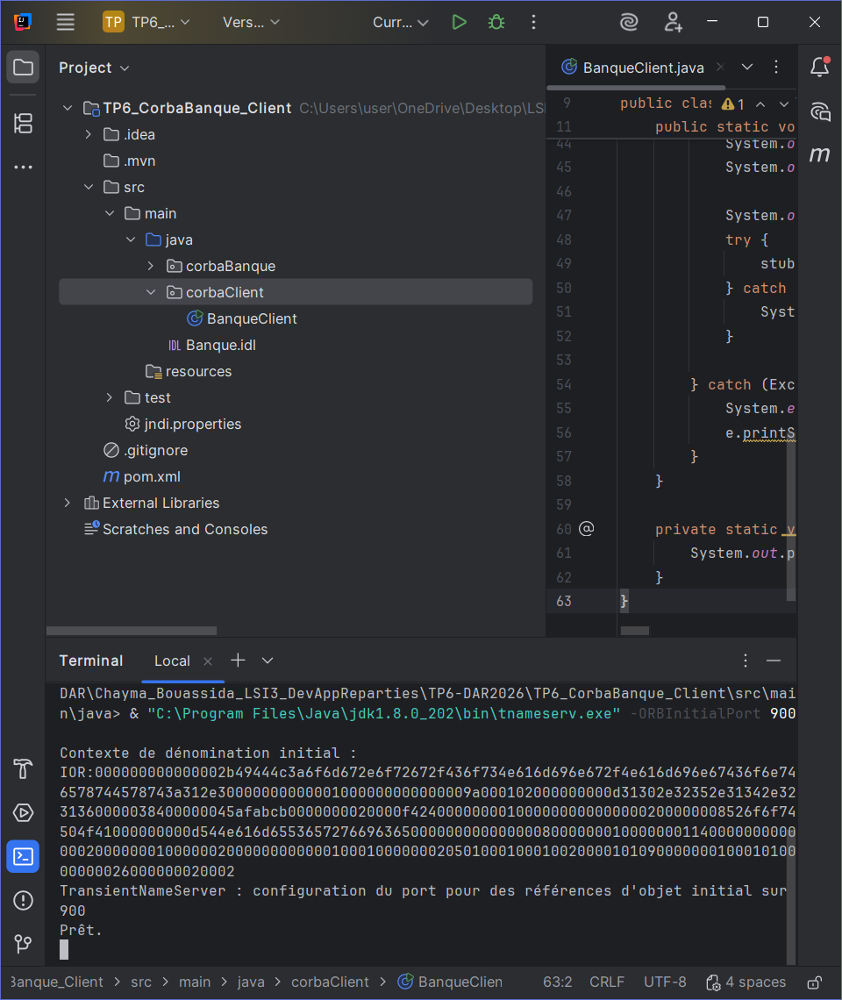
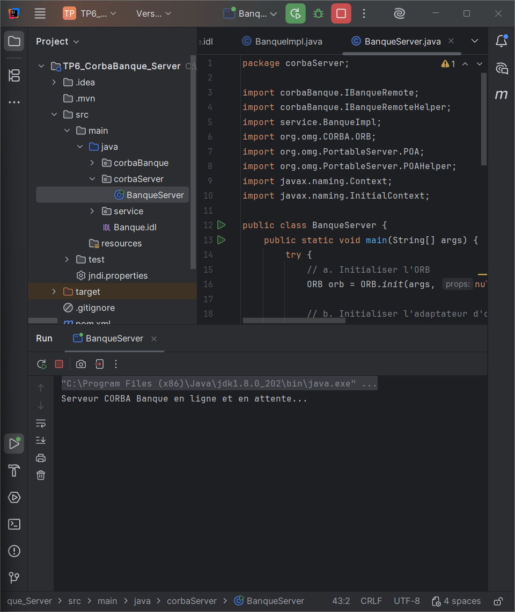
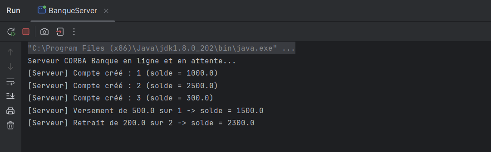
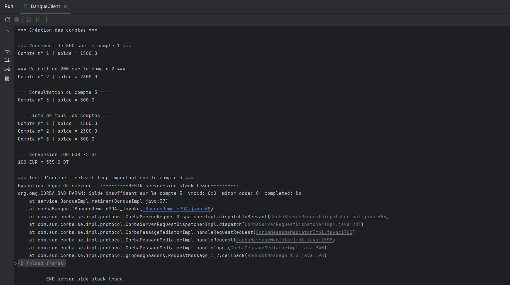

# TP6 - Implémentation d'un Service Banque en CORBA

**Étudiant :** Chayma Bouassida  
**Matière :** Développement d'applications réparties  
**Année universitaire :** 2026 – 2027

Ce projet implémente une application distribuée Client-Serveur en utilisant le middleware **CORBA** (Common Object Request Broker Architecture) pour la gestion de comptes bancaires (création, versement, retrait, consultation, conversion).

---

# Étape 1 : Préparation de l'environnement

⚠️ **Important :** L'outil de compilation IDL (`idlj`) et l'annuaire de noms (`tnameserv`) ayant été retirés des versions récentes de Java, ce projet a été développé et exécuté avec le **JDK 1.8 (Java 8)**.

### Configuration du SDK

Le projet est configuré pour utiliser le SDK Java 1.8.0_202.

---

# Étape 2 : Développement du Serveur

Le projet serveur (`TP6_CorbaBanque_Server`) contient les packages `corbaBanque` (généré par IDL), `service` (implémentation métier) et `corbaServer` (démarrage).

## 1. Définition de l'interface IDL (`Banque.idl`)
```idl
module corbaBanque {
    struct Compte {
        long  code;
        float solde;
    };

    typedef sequence<Compte> tabComptes;

    interface IBanqueRemote {
        void       creerCompte(in Compte cpte);
        void       verser(in float mt, in long code);
        void       retirer(in float mt, in long code);
        Compte     getCompte(in long code);
        tabComptes getComptes();
        double     conversion(in float mt);
    };
};
```
Ce fichier définit la structure des données (`Compte`) et les méthodes distantes indépendamment du langage de programmation. Il a été compilé avec la commande `idlj -fall -v Banque.idl` pour générer les classes Java nécessaires (Stubs et Skeletons).

## 2. Configuration JNDI (`jndi.properties`)
```java
java.naming.factory.initial=com.sun.jndi.cosnaming.CNCtxFactory
java.naming.provider.url=iiop://localhost:900
```
Ce fichier permet au serveur et au client de localiser l'annuaire de noms (Naming Service) sur le port 900.

## 3. L'implémentation du Servant (`BanqueImpl.java`)
Le servant hérite de `IBanqueRemotePOA`. Il gère la logique métier : stockage des comptes, calcul de conversion (1 EUR = 3.35 DT) et lève des exceptions CORBA (`BAD_PARAM`) en cas de solde insuffisant ou de tentative de création d'un compte déjà existant.

## 4. Le Serveur (`BanqueServer.java`)
Le serveur initialise l'ORB, active le POA (Portable Object Adapter) et enregistre l'objet sous le nom `"BanqueService"` dans l'annuaire JNDI.

---

# Étape 3 : Développement du Client

Le projet client (`TP6_CorbaBanque_Client`) contient le code généré (`corbaBanque`) et la classe `BanqueClient`. Le client utilise `InitialContext` pour faire un `lookup` du service et récupère le Stub (via `IBanqueRemoteHelper`) pour invoquer les méthodes distantes comme si elles étaient locales.

---

# Étape 4 : Exécution de l'application

L'exécution de CORBA nécessite le lancement de 3 composants dans un ordre strict.

## 1. Démarrage de l'annuaire de noms (`tnameserv`)
Le service d'annuaire doit être lancé en premier pour permettre au serveur et au client de se rencontrer.


## 2. Démarrage du Serveur et Logs en temps réel
Une fois le serveur lancé, il s'enregistre auprès de l'annuaire et affiche en temps réel les requêtes envoyées par le client.



*(On y voit clairement la création des comptes 1, 2, et 3, ainsi que le versement de 500 DT sur le compte 1 et le retrait de 200 DT sur le compte 2).*

## 3. Exécution du Client et Résultats
Le client invoque les méthodes distantes. La console affiche les résultats des opérations demandées et gère proprement les erreurs.


### Analyse des résultats :
- **Création** : Les comptes 1, 2 et 3 sont créés avec succès.
- **Versement** : 500 DT ajoutés au compte 1 (nouveau solde : 1500.0).
- **Retrait** : 200 DT retirés du compte 2 (nouveau solde : 2300.0).
- **Consultation** : Le compte 3 affiche bien son solde (300.0).
- **Liste** : Affichage de tous les comptes.
- **Conversion** : 100 EUR équivaut à 335.0 DT.
- **Gestion des erreurs** : Le test de retrait excessif sur le compte 3 a bien déclenché l'exception CORBA `BAD_PARAM: Solde insuffisant sur le compte 3`, qui a été interceptée proprement par le client (sans faire planter l'application).

---

# Synthèse

Ce TP a permis de mettre en œuvre le middleware **CORBA** en Java :
1. **IDL (Interface Definition Language)** : Définition des structures de données et des interfaces indépendamment du langage de programmation.
2. **ORB (Object Request Broker)** : Le "cerveau" qui gère la communication réseau (via IIOP) entre les objets.
3. **POA (Portable Object Adapter)** : Permet de relier l'implémentation (Servant) à l'ORB.
4. **JNDI** : Utilisé comme annuaire (Naming Service) pour permettre au client de localiser l'objet distant (`lookup`).
5. **Stub & Skeleton** : Le client utilise le Stub généré pour invoquer les méthodes comme si elles étaient locales, et le serveur utilise le Skeleton (POA) pour recevoir ces appels.